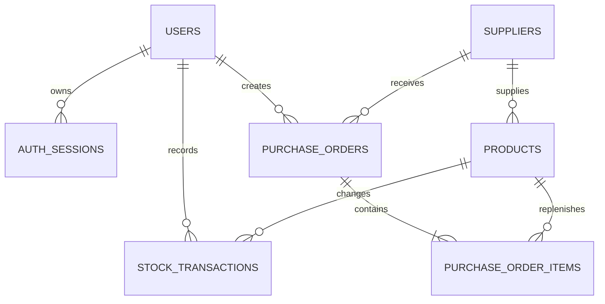

# Stockwise — VCube Hack Quest

Responsive inventory and supply-chain management built with Spring Boot 3, Spring Security, MySQL, React, and Vite. It includes authenticated role-aware workflows, audit-friendly stock movements, itemized purchasing, reporting, and four live-data AI endpoints.

## Project layout

- `backend/` — Spring Boot REST API, JPA domain, security, services, and database migration/seed logic.
- `frontend/` — React/Vite dashboard with responsive layouts, charts, auth, inventory, supplier, purchasing, reports, and AI views.
- `schema.sql` — reference MySQL schema (the app also upgrades the existing local schema additively on startup).
- `postman_collection.json` — API requests with token capture on login.
- `docker-compose.yml` — local container stack for the API, UI, and MySQL.

## Run with your local MySQL

Prerequisites: Java 21, Node.js 20+, and MySQL 8. Create/select the `supply_chain_mgmt` database. Copy `.env.example` to `.env`, then set your MySQL password, a random JWT secret (at least 32 characters), and optionally a Gemini or OpenAI key. `.env` is ignored by Git.

```sh
cp .env.example .env
# Edit .env with your local settings. Never paste the real secrets into source files.

# Terminal 1 — API at http://localhost:8082
cd backend
set -a; source ../.env; set +a
./mvnw -Dmaven.repo.local=../work/maven-repo spring-boot:run

# Terminal 2 — UI at http://localhost:5173
cd frontend
npm install
npm run dev
```

First startup preserves existing tables and data, adds missing fields, and fills demo catalog rows only as needed. Configure `BOOTSTRAP_ADMIN_EMAIL` and `BOOTSTRAP_ADMIN_PASSWORD` in `.env`; the configured account is promoted to `ADMIN` on startup. Registration creates `STAFF` accounts. Do not use demo/bootstrap credentials in a public deployment.

## Docker Compose

Set `DB_PASSWORD`, `JWT_SECRET`, and optional AI key in `.env`, then run from the repository root:

```sh
docker compose up --build
```

UI: `http://localhost:3000`; API: `http://localhost:8082`. Compose uses a separate MySQL volume and does not connect to the MySQL instance on your host.

## Authentication and roles

Register and log in at `/api/auth/register` and `/api/auth/login`. Registration creates a `STAFF` account and returns to sign-in; a separate login then returns a signed bearer token. Users cannot choose elevated roles during public registration. A staff member can submit a manager access request in **Settings**; an administrator reviews it in **Settings → Manager access requests**. Admins can also assign roles directly in **Workspace users**. The frontend stores the token in session storage and sends it on API requests. Sessions are persisted as token hashes, expire, and can be revoked by logout. `/api/auth/me` returns the current identity.

| Capability | STAFF | MANAGER | ADMIN |
|---|:---:|:---:|:---:|
| Read catalog, suppliers, orders, reports, AI | ✓ | ✓ | ✓ |
| Record stock movement | ✓ | ✓ | ✓ |
| Create/update products and suppliers | — | ✓ | ✓ |
| Create and transition purchase orders | — | ✓ | ✓ |
| Delete products/suppliers; manage user roles | — | — | ✓ |

## Main API

All routes below except register/login require `Authorization: Bearer <token>`.

| Area | Routes |
|---|---|
| Auth | `POST /api/auth/register`, `POST /api/auth/login`, `GET /api/auth/me`, `POST /api/auth/logout`; manager access requests `POST /api/auth/role-requests`, `GET /api/auth/role-requests/me`, admin `GET /api/auth/role-requests`, `PATCH /api/auth/role-requests/{id}`; admin `GET /api/auth/users`, `PATCH /api/auth/users/{id}/role` |
| Products | `GET/POST /api/products`, `GET/PUT/DELETE /api/products/{id}`, `GET /api/alerts/low-stock` |
| Suppliers | `GET/POST /api/suppliers`, `GET/PUT/DELETE /api/suppliers/{id}` |
| Purchasing | `GET/POST /api/purchase-orders`, `PATCH /api/purchase-orders/{id}/status` |
| Stock | `GET/POST /api/stock-transactions` (types `STOCK_IN`, `STOCK_OUT`, `ADJUSTMENT`) |
| Reports | `GET /api/dashboard`, `/api/reports/sales`, `/api/reports/stock-movement` |
| AI | `GET /api/ai/forecast/{productId}`, `POST /api/ai/optimize`, `/api/ai/purchase-recommendations`, `/api/ai/chat` |

Example AI chat body: `{"question":"Which products may stock out soon?"}`. AI requests receive current database context. Provider failures or absent keys return deterministic live-data recommendations with `source: RULE_BASED_FALLBACK`.

## AI provider configuration

The backend invokes models through Spring AI's `ChatClient` and OpenAI-compatible chat model. Gemini is the default endpoint (`GEMINI_API_KEY`, `AI_MODEL=gemini-3.5-flash-lite`, `AI_BASE_URL=https://generativelanguage.googleapis.com/v1beta/openai`). To target OpenAI, set `AI_API_KEY`, `AI_BASE_URL=https://api.openai.com`, and an OpenAI model name. Keep keys in the ignored local `.env` file and backend environment only. AI prompts include live inventory, supplier, order, and stock movement data relevant to each operation. Forecasts use recent stock-out history and clearly expose limited-history confidence; they do not claim long-term seasonality from a short window. A deterministic live-data fallback keeps the AI endpoints useful when the provider is unavailable or no key is configured. Spring AI is initialized only when an API key is configured, so the application starts in fallback mode without a key.

## Aiven deployment

Set `SPRING_PROFILES_ACTIVE=aiven`, `MYSQL_HOST`, `MYSQL_PORT`, `MYSQL_DATABASE`, `MYSQL_USER`, `MYSQL_PASSWORD`, `JWT_SECRET`, `APP_CORS_ALLOWED_ORIGIN_PATTERNS=https://your-frontend-host.example`, and AI provider secrets in the backend host's secret settings. The Aiven profile requires TLS. Build the frontend with `VITE_API_URL=https://<your-api-host>/api`; deploy the static `frontend/dist` directory to a static host.

## Data model

The six required operational entities are `users`, `suppliers`, `products`, `purchase_orders`, `purchase_order_items`, and `stock_transactions`. Auth sessions are stored separately to support token revocation.



## Hackathon run-through

1. Sign in with the configured bootstrap administrator; create accounts through registration (they start as `STAFF`) and assign manager access in **Settings → Workspace users**.
2. Demonstrate product search/filters, supplier details, receiving/dispatch stock transactions, and low-stock alerts.
3. Create a draft purchase order, approve/order it, then receive it to apply stock and generate an audit transaction.
4. Open AI Insights for forecast, reorder-level optimization, supplier-grouped purchase recommendations, and natural-language Q&A.
5. Review movement/sales reports and export CSV from the dashboard.

Import `postman_collection.json` into Postman. `baseUrl` defaults to `http://localhost:8082`; the login request stores the token for subsequent calls.
